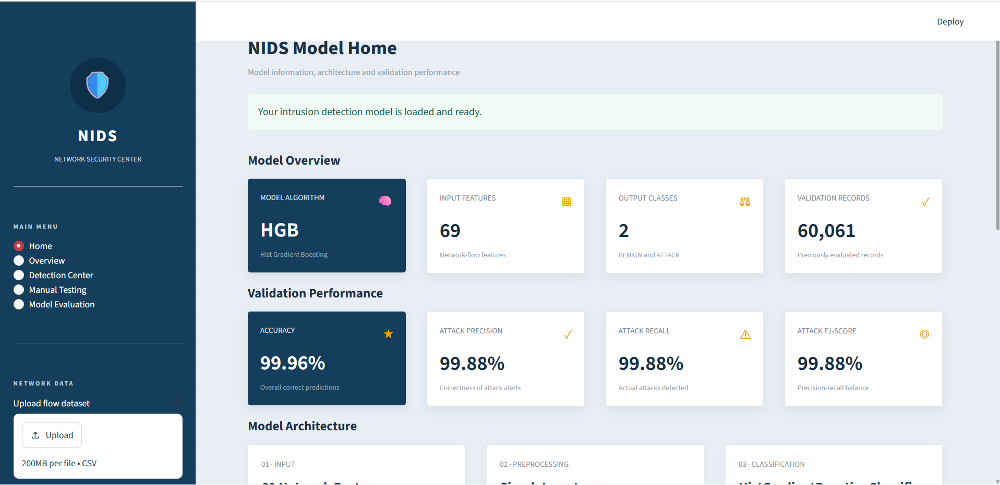

# Network Intrusion Detection System (NIDS)

## Project Overview

This project develops a machine learning-based Network Intrusion Detection System using the CIC-IDS2017 dataset.

The system classifies network traffic into two categories:

- **BENIGN:** Normal network traffic.
- **ATTACK:** Potential malicious network traffic.

A Streamlit dashboard provides CSV upload, individual flow testing, and prediction results.

## Dataset

- Dataset: CIC-IDS2017
- Features used: 69
- Training data: Monday to Thursday
- Independent testing data: Friday
- Task: Binary classification

Dataset source: https://www.unb.ca/cic/datasets/ids-2017.html

## Technologies

- Python
- Pandas and NumPy
- Scikit-learn
- Matplotlib and Plotly
- Streamlit
- Joblib

## Machine Learning Models

- Logistic Regression
- Random Forest
- Extra Trees
- Histogram Gradient Boosting

The family-aware Histogram Gradient Boosting model is used by the prediction module.

## Project Structure

- `dashboard/` – Streamlit dashboard
- `data/` – Raw and processed datasets
- `models/` – Saved machine learning models
- `results/` – Evaluation results
- `src/` – Data preparation, analysis, training and prediction scripts
- `requirements.txt` – Python dependencies

## Installation

Create a virtual environment:

```powershell
python -m venv .venv
```

Activate it:

```powershell
.\.venv\Scripts\Activate.ps1
```

Install dependencies:

```powershell
python -m pip install -r requirements.txt
```

## Run the Dashboard

From the project root:

```powershell
streamlit run dashboard/app.py
```

## Prediction Model

The prediction module is `src/predict.py`.

The expected model file is:

`models/hist_gradient_boosting_family_aware.joblib`

The model requires the 69 expected network traffic features.

## Dataset

This project uses the CIC-IDS2017 dataset provided by the Canadian Institute for Cybersecurity.

The original dataset files are not included in this repository because of their large size.

**Dataset download:** https://www.unb.ca/cic/datasets/ids-2017.html

Download the dataset and place the required CSV files in the appropriate data directory before running the preprocessing scripts.

## Dashboard Preview

